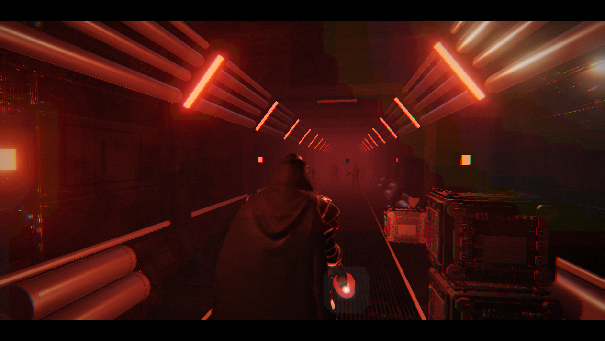

# RAGE — offline mirror

Full mirror of **RAGE** (https://darths-rage.netlify.app/) — "Rage", a
single-file three.js action game: a Netlify deploy with the entire game in one
entry document.

Source: https://darths-rage.netlify.app/



## Stack

- **Single-file three.js game** — the whole game (rendering, physics, AI,
  audio, HUD) is one ~170 KB inline `<script>` plus two inline `<style>`
  blocks inside a 182,970 B `index.html`; the capture is that document plus
  its runtime asset bank (MP3s, WebP textures, glTF model/geometry JSON
  payloads, favicon)
- **three.js r147 from jsdelivr — stays external** — nine CDN `<script src>`
  loads (`three@0.147.0/build/three.min.js` plus `examples/js` shaders,
  postprocessing, loaders and utils: CopyShader, LuminosityHighPassShader,
  EffectComposer, RenderPass, ShaderPass, UnrealBloomPass, GLTFLoader,
  SkeletonUtils) are not captured (socker precedent, PLAN §1: never backfill
  a CDN dependency into the capture). A local serve therefore runs the game
  only with internet access for those nine scripts; without them the page
  shows its own "The 3D engine failed to load" guard
- **Google Fonts — stays external** — the `Big Shoulders Display` /
  `Share Tech Mono` stylesheet and font origins are off-origin references,
  recorded in `_mirror-report.json` (`external`), never captured
- **procedural + glTF-Transform models** — four character/prop families
  (Sevrane, trooper, courier, crate) are served as `*-model.json` +
  `*-geometry.json` glTF-Transform v4.5.1 payloads with WebP textures,
  loaded by hand through `THREE.GLTFLoader.parse()`

## What this is

RAGE (darths-rage.netlify.app) — a single-file browser action game: you play
Sevrane, a courier boarding a ship, igniting a red energy blade, fighting
guards through the corridors, gripping crates and blast doors and carrying a
data card to the escape. The whole game is one entry document: the inline
script builds the scene, the ship, the AI, the blade and the post-processing
with three.js r147 (loaded from jsdelivr), and pulls its asset bank from the
origin root. Captured whole, byte-exact under `.upstream/manifest.json`:
**72 files, 13,069,690 bytes** — the entry document (182,970 B, the
170,041 B inline game script and two inline stylesheets), 40 MP3s (music,
blade hum start/loop, ignition, breathing, spin, stress, blaster, ten
deflection whooshes, twenty-two swing whooshes), 22 WebP textures (logo,
Sevrane/trooper/courier/crate), favicon.ico and eight glTF
model/geometry JSON payloads.

The runtime closure was driven to a fixpoint by `tools/capture.mjs`, then
cross-checked against an opencli browser network log recorded while the game
was played on loopback: 84 requests, **72/72 captured files actually
requested, 0 same-origin requests missing, 0 failures** — the cross-check is
what found the trooper/courier/crate model bank (the static scan saw only the
`prefix+'-model.json'` template), which was fetched from the origin and
added before the capture was frozen.

## Layout

- `index.html` — the capture at the origin root (served paths = on-disk
  paths; inline game script + styles)
- `.upstream/manifest.json` — sha256 + bytes for every captured file (Gen-A)
- `_mirror-report.json` — crawl record: request count, fetched paths,
  recorded 404 gaps, external references
- `readable/` — prettified derived layer (pinned prettier 3.9.6):
  `index-inline-1.pretty.js` (the game, 7,869 lines),
  `index-inline-1.pretty.css` (508 lines), `index-inline-2.pretty.css`
  (7 lines) + `index-inline-map.json` (byte ranges + sha256)
- `src/` + `split-spec.json` + `rename-map.json` — the reversed layer:
  35 section-aligned slices named after the game's own 21 section banners
  (`src/boot.js`, `src/helpers.js`, `src/level-a.js`, …, `src/updates-d.js`,
  `src/loop.js`); `split-spec.json` records the derivation (42 sections:
  35 slices + 5 skipped + 2 wholeFile, with a `structure` evidence block and
  a `rename` record) and `rename-map.json` the recovered semantic rename
  layer (187 word-boundary + 24 indexed records)
- `legacy/2026-10-14/` — the superseded derived layer (the 2026-10-13
  28-slice flat `src/` + `readable/` + its `split-spec.json`), kept per
  PLAN §3
- `docs/cover.png` — gameplay cover; `docs/boot-2026-10-13.png` — boot
  evidence; `docs/boot-network-2026-10-13.json` — the opencli network log
  from the play test
- `tools/capture.mjs` — byte-exact capture + runtime-closure fetch (`--check`
  for a residual closure audit)
- `tools/derive.mjs` — rebuild `readable/` + `src/` + `split-spec.json`
  (section-aligned slicing; re-applies the recorded rename map on re-cut)
- `tools/verify.mjs` — re-hash the capture against the manifest
- `tools/update.mjs` — read-only drift probe against the live origin
- `tools/audit.js` — integrity gate for the derived layers + rename map
  (`AUDIT PASS`)
- `tools/net-crosscheck.mjs` — compare an opencli network log against the
  manifest (dynamic closure check)
- `tools/names.json` — the reviewed rename worklist (46 rules, evidence in
  the file's `__note`)
- `tools/apply-names.mjs` — the scope-aware campaign writer (chunk scope =
  the IIFE body's function scope, so nested shadowing is untouched)
- `tools/recover-scoped-map.mjs` — recovers the exact map from the committed
  slices into `rename-map.json` by token alignment
- `tools/verify-rename.mjs`, `tools/check-chunk.mjs`, `tools/refcheck.mjs`,
  `tools/engine/rename-layer.mjs` — the per-slice and cross-slice rename
  gates (the shared tokenizer/application all writers and gates splice
  through)
- `tools/probe-structure.mjs` — structure evidence (source-map scan, ESM
  census, section-banner/window report)
- `tools/lib-acorn.mjs` — authoring-time acorn (installed into the
  gitignored `tools/.deps/` on first use; never shipped, never needed at
  runtime)

## Assets

- **audio** — 40 file(s), origin root: `music.mp3` (1,127,445 B loop),
  `hum_loop.mp3`, `hum_start.mp3`, `ignition.mp3`, `breathing.mp3`,
  `spin.mp3`, `stress.mp3`, `blaster.mp3`, `deflect0-9.mp3` (10 deflection
  whooshes), `swing0-21.mp3` (22 swing whooshes)
- **images** — 22 WebP + 1 ICO: `logo.webp` (title logo),
  `sevrane-Image_0-2.webp`, `trooper-Image_0-2.webp`, `courier-tex*.webp`
  (7), `crate-tex*.webp` (8) — character/prop textures; `favicon.ico`
- **models** — 4 families as glTF-Transform v4.5.1 JSON payloads:
  `sevrane-`, `trooper-`, `courier-`, `crate-` each with `-model.json`
  (materials/images/skins/animations) and `-geometry.json` (mesh/index/
  vertex buffers as base64), loaded via `THREE.GLTFLoader.parse()`

## Run

Open `index.html` through any static file server (the capture is a static
site served at the origin root; no build step):

```
npx serve .
```

Internet is required for the nine jsdelivr three.js r147 scripts and the
Google Fonts stylesheet (they stay CDN by design). With them reachable the
game boots from the captured files alone: the boot evidence in
`docs/boot-2026-10-13.png` was taken through a local serve on loopback, and
the cover shows actual gameplay (Sevrane in the corridor, blade ignited,
crates and guards in view).

## Verify

```
node tools/verify.mjs     # re-hash the capture against the manifest → 72 files checked, 0 problems
node tools/audit.js       # derived-layer + rename-map integrity gate → AUDIT PASS
node tools/verify-rename.mjs --all   # per-slice reproduction + references/bindings
node tools/check-chunk.mjs --all     # cross-slice calls resolve after renames
node tools/derive.mjs     # re-cut the derived layers; self-check clean
node tools/capture.mjs --check       # residual closure audit → 0 new unresolved
node tools/probe-structure.mjs       # structure evidence (source maps, ESM census, sections)
node tools/check-exports.mjs         # the derived layer still exports every public name
```

## Updating from upstream

```
node tools/update.mjs     # read-only drift probe: what changed upstream
```

The probe never rewrites the capture — a mirror is a point-in-time snapshot.
Only captured (same-origin) files are probed: the manifest is the closure,
and the CDN dependencies (jsdelivr three.js r147, Google Fonts) have no
manifest entries — they are external by design, documented in
`_mirror-report.json` and listed by `tools/capture.mjs --check`, so they are
never probed as if local. Netlify serves the entry at both `/` and
`/index.html`; the probe keeps the root-form fallback. Refreshing means
re-fetching into a clean tree (`node tools/capture.mjs`), re-cutting the
manifest, and re-deriving `readable/` + `src/` from the new entry document
with `node tools/derive.mjs`.

### 2026-10-13 capture + readable/src derivation

> **Superseded 2026-10-14** by the structure pass + rename campaign below:
> the 28 `src/index-inline-1-NN.js` statement-window slices described here
> were re-cut into 35 section-named slices (`src/boot.js`, `src/level-a.js`,
> …) and the flat layer is archived at `legacy/2026-10-14/`. Kept as the
> record of the first-cut derivation.

- **Capture** (byte-exact, nothing edited): 72 files, 13,069,690 bytes —
  `index.html` (182,970 B) containing the 170,041 B inline game script and
  two inline `<style>` blocks (8,228 B + 63 B), 40 MP3s, 22 WebP textures,
  `favicon.ico` and 8 glTF model/geometry JSON payloads (largest:
  `sevrane-geometry.json`, 3,833,126 B). Closure was driven to a fixpoint by
  `tools/capture.mjs` (74 requests, 3 rounds): entry document → inline script
  refs → the four model families (`sevrane` literal + `trooper`/`courier`/
  `crate` runtime templates, enumerated in the tool's KNOWN list because the
  scanner only sees `prefix+'-model.json'`) → the models' own texture images
  (`trooper-Image_N.webp`, `courier-tex*.webp`, `crate-tex*.webp`, closed
  over from the captured JSON) → `favicon.ico`. The two recorded 404s
  (`-model.json`, `-geometry.json`) are the bare template fragments the
  scanner probes before the prefix bindings are known — they are never
  requested at runtime, and both concrete families resolve to captured
  files; they stay in `_mirror-report.json` as probed-and-recorded gaps so
  `--check` proves 0 *new* unresolved references. External (never captured):
  nine jsdelivr three.js r147 scripts + three Google Fonts origins.
- **Dynamic closure cross-check** — the mirror was served on loopback and
  played through an opencli browser session; the recorded network log
  (`docs/boot-network-2026-10-13.json`, 84 requests) contains **zero
  same-origin requests that are not captured files**, all 72 captured files
  were actually requested by the running game, and there were zero failed
  requests. The only off-origin traffic is the CDN set above (plus one
  embedded `data:` texture).
- **readable/** — pinned prettier 3.9.6 (module API, default options, single
  pass verified idempotent — never the CLI, it respects `.gitignore` and can
  silently echo its input) rendered the inline game script to
  `readable/index-inline-1.pretty.js` (7,869 lines) and the two inline
  `<style>` blocks to `readable/index-inline-1.pretty.css` (508 lines) and
  `readable/index-inline-2.pretty.css` (7 lines). Every pretty is provably
  not a byte copy of its capture block and re-renders byte-exact under the
  pinned version. Block numbering is per tag kind (the fleet convention):
  `index-inline-1.pretty.js` is script block #1, `index-inline-1|2.pretty.css`
  are style blocks #1 and #2.
- **Inline blocks** — all three content blocks get whole-file twins plus
  `readable/index-inline-map.json` recording each block's exact byte range +
  sha256 inside `index.html`. The nine external `<script src>` CDN loads are
  not derived (external by design).
- **src/** — 28 statement-aligned slices (`src/index-inline-1-NN.js`, exact
  2-line provenance header) recorded in `split-spec.json` (35 sections):
  28/28 parse standalone (`node --input-type=module --check -`) and
  round-trip byte-exact to their readable line ranges. The inline script is
  a single top-level IIFE (`(() => { … })();`), so slices are cut at the
  IIFE body's top-level statement boundaries (~250–350 line windows;
  oversized single declarations stay whole; the `"use strict"` directive
  prologue heads the first slice). Non-standalone parts are skipped sections,
  indexed but never sliced (5): the IIFE wrapper head and tail, and the three
  body statements that carry a top-level `return` (the engine guard and two
  other early-exit guards) — a `return` is not valid at module top level, so
  those ranges could never parse standalone.
- **Stylesheet rule** — the two inline `<style>` blocks are wholeFile
  sections, never sliced.
- **notRendered** — 71 hashed payload records in `split-spec.json` (40 audio,
  22 images + favicon, 8 glTF data JSONs; bytes + sha256, no pretty pass).
- **Gates**: `node tools/verify.mjs` → `72 files checked, 0 problems`;
  `node tools/audit.js` → `AUDIT PASS` (28/28 round-trips, 3/3 pretty
  sources tiled, 5/5 skipped sections re-verified textually, 3/3 pretties
  re-render byte-exact, inline-script shape guard held);
  `node tools/capture.mjs --check` → `0 new unresolved`; independent 3-slice
  round-trip check → 3/3 byte-exact + header-exact + parse standalone;
  `node tools/update.mjs` → `up to date: 72 captured files identical
  upstream`. Boot test: mirror served on loopback, opened through opencli —
  title screen rendered (`docs/boot-2026-10-13.png`), a key started the run,
  Space ignited the blade, arrows walked/turned and the blade was swung; the
  cover shows live gameplay (Sevrane in the ship corridor, ignited blade,
  crates, guards ahead). Serve probe: entry + `music.mp3` +
  `sevrane-model.json` + `trooper-Image_1.webp` + `swing21.mp3` over HTTP 200
  at their recorded sizes, listener PID killed, port proven closed
  (`netstat` + connection refused).
- **§0.4 fork-over-mirror checked 2026-10-13**: no public upstream source
  repo exists — the captured content carries no github/gitlab/bitbucket
  reference (the only off-origin URLs in captured text are the nine jsdelivr
  script URLs, the Google Fonts origins and the Netlify hosting-promo comment
  in the entry head), a GitHub search for the project finds only this
  mirror's own repo, and the glTF payloads name only the export tool
  (`glTF-Transform v4.5.1` — a library credit, not an upstream source repo).
  The mirror stands.
- **Open task (PLAN §5), closed 2026-10-14**: the first pass left
  identifiers as bundled and recorded the deep identifier-rename campaign as
  an open task. It was run on 2026-10-14 — see the structure-pass section
  below; the finding was that the script is authored (not minified) and only
  46 opaque chunk-scope bindings needed naming. Rebuild the derived layers
  any time with `node tools/derive.mjs`.

### 2026-10-14 structure pass + identifier rename campaign (the open task, closed)

Mission of this pass: converge the derived layers on the real project shape
("keep reversing to achieve exact folder structure file splitting") and run
the PLAN §5 identifier rename campaign. The capture was **not** touched —
`node tools/verify.mjs` still re-hashes all 72 files (0 problems) — so this
section is entirely about `readable/`, `src/`, `split-spec.json`,
`rename-map.json`, `tools/` and `legacy/`.

- **Inventory (source maps + module boundaries) — recorded by
  `tools/probe-structure.mjs`**:
  - *Source maps*: **0** `sourceMappingURL` occurrences and **0** `*.map`
    files across the 72 captured files (scanned byte-wise), so no original
    tree can be reconstructed from maps; the derivation stays a
    prettier/slice pass.
  - *Module boundaries*: the inline script is one classic **IIFE** — 1
    top-level statement, 340 body statements, **0 import / 0 export
    occurrences**, no factory family, no export table. The factory-extraction
    precedents (spawn-dust-2-dm / mindfall / kettuvellam) are therefore not
    applicable; the stillwater / taipei-rush-tokyo flat-script precedent
    applies.
- **Structure — the real boundaries the bytes declare are the author's own
  21 section banners** (`/* ================= level ================= */`,
  two-space indent, IIFE body level: helpers, renderer, textures, materials,
  level, space, lights, Sevrane, soldiers, particles, audio, state, input,
  speech, combat helpers, poses, updates, camera, modes, HUD, loop). The
  2026-10-13 pass had ignored them and cut arbitrary ~250–350-line statement
  windows; slices now start at a section banner, a section larger than the
  350-line window cap splits further at statement boundaries into `-a/-b/…`
  parts (desimayhem's `world-city-a..g` precedent), and the slice files are
  **named after the sections**. Before/after counts: `src/` 28 flat
  `index-inline-1-NN.js` windows → **35 section-aligned slices across 22
  sections** (`boot`, 21 banner sections); `split-spec.json` sections 35 →
  **42** (35 slices + 5 skipped + 2 wholeFile; kind
  `section-aligned-slices`, with a `structure` evidence block and a `rename`
  record); `readable/` unchanged (4 files — the inline twins and their map);
  the superseded 28-slice layer is archived at `legacy/2026-10-14/`. Slice
  headers read `// level-a — level (part 1 of 3)` /
  `// Lines 557-590 of readable/index-inline-1.pretty.js (statement-aligned).`
- **Rename campaign (PLAN §5) — applied and gated**: the finding that shaped
  the campaign is that RAGE's script is **authored, not minified**: of the
  312 chunk-scope (IIFE-body) bindings, 266 already carry the author's own
  semantic names (`renderer`, `scene`, `camera`, `player`, `crates`, …).
  `tools/names.json` therefore renames only the **46 genuinely opaque
  short bindings — all 46 fired, 0 refused, 1,052 identifier positions**
  spliced: the utility aliases (`$`→`byId`, `V3`→`vec3`, `glc`/`fx`→
  `glCanvas`/`fxCanvas`, `PR`→`pixelRatio`, `mk`→`makeMesh`, the seeded RNG
  `trand`/`tr`/`tseed`→`seededRandom`/`seededRange`/`seed`), the level
  constants (`DW/DH`→`DOOR_W/DOOR_H`, `CW/CH`→`CORRIDOR_W/CORRIDOR_H`,
  `BW/BH`→`BAY_W/BAY_H`), the state objects (`M`→`materials`,
  `P`→`sevraneParts`, `G`→`soldierGeo`, `TR`/`TRB`→`trooperModel`/
  `trooperBones`, `CR`→`crateHalf`, `A`→`audioEngine`, `T`→`elapsed`,
  `lb`→`letterbox`, `q`→`inputLatch`, `UP`→`upAxis`, `QI`→`identityQuat`)
  and the scratch family (`_q/_q2/_qp`→`scratchQuat*`,
  `_a/_b/_d/_e`→`scratchVec*`, `_cm/_cm2`→`scratchMatrix*`,
  `_ta.._td`→`scratchTroop*`, `_qd1..3`/`_ax`→`scratchDoor*`, `_one`→
  `unitScale`, `_c2`→`scratchBladeDir`). Applied by `tools/apply-names.mjs`
  (chunk scope = the IIFE body's function scope, so every nested local named
  `A`, `q`, `mk`, … is untouched), recovered mechanically into
  `rename-map.json` (**187 word-boundary + 10 indexed names over 24
  occurrences**, 35/35 slices aligned over 66,442 token positions, 34
  renamed slices), and re-applied by `tools/derive.mjs` on every re-cut.
- **One deliberate tool adaptation, proven by the gates**: the fleet
  precedent refuses a rename when the *name* appears anywhere in a shorthand
  position (`{x}` / `const {x} = …`) because key and value share one token.
  Here that rule refused `A`→`audioEngine` because a *nested local* `A`
  (a per-soldier sub-object in the soldiers section) appears as `{A}` — a
  different binding. `tools/apply-names.mjs` now resolves the shorthand
  value first and refuses only when it actually resolves to the **chunk
  scope**; the chunk-scope `A` has no shorthand occurrence, so the rename
  fires and `verify-rename`/`check-chunk` prove the result
  (references+bindings YES, cross-slice calls resolve YES).
- **What the campaign deliberately does not rename** (honest scope):
  - **the 266 authored-semantic chunk bindings** — renaming them would
    destroy the author's naming, not recover it;
  - **locals inside function bodies** — the campaign renames chunk-scope
    bindings only (evidence: the local `q` quaternions in the level builders,
    the local `mk` texture-maker inside `sharedTex`, the local `A`/`T` in the
    soldier/cutscene code all keep their names);
  - **vendor/global identifiers** — `THREE.*` properties, DOM/WebAudio
    globals, GLSL text inside template literals (there are no local three.js
    files: the nine jsdelivr r147 scripts stay CDN, so the vendor rule is
    vacuous here beyond the CDN references);
  - **the author's level-constant family** (`ZSTART`, `CEND`, `BZ1`,
    `DOORS`, `AIRLOCK`, `HILT`, `SEV`, the pose `P.*` keys) and numeric
    scratch names (`cut`, `SPN`, `SPK`, `FIX`, `spI`, `smI`) — consistent
    authored abbreviations with local meaning.
- **Gates (verbatim tails, 2026-10-14)**:

```
node tools/verify.mjs
72 files checked, 0 problems

node tools/audit.js
AUDIT PASS — 42 spec sections (35/35 src↔pretty round-trips byte-exact through the recorded rename map, 34 renamed slice(s), 3/3 pretty sources tiled contiguously, 5/5 skipped non-standalone sections re-verified textually, 35/35 src slices + 1/1 readable/*.pretty.js parse standalone (node --input-type=module --check -), 3/3 pretties provably distinct from their capture source, 7 index-only wholeFile/skipped sections carry no src file, 3 inline content block(s) with twins + index-inline-map.json, 0/0 imports resolve inside the capture (0 whitelisted machinery), rename map: 187 word-boundary + 24 indexed record(s) over 34 slice(s) (10 scoped slice(s) token-validated, no foreign position), 3/3 source provenance record(s) re-verified, 71/71 notRendered record(s) re-hashed, 3/3 pretties re-render byte-exact under pinned prettier 3.9.6 (format-to-fixed-point), inline-script shape guard held, capture manifest free of derived layers)

node tools/verify-rename.mjs --all
readable/index-inline-1.pretty.js: 35 slice(s), 34 renamed, reproduces: 35/35, references ok: YES, bindings ok: YES
verify-rename: 35/35 slice(s) reproduce byte-exact, 34 renamed slice(s) (24 indexed occurrence(s)), 1/1 chunk(s) references+bindings YES

node tools/check-chunk.mjs --all
readable/index-inline-1.pretty.js: 35 ranged slice(s) (40 section(s) in the reconstruction), 35 substituted
  cross-slice calls resolve: YES
check-chunk: 1 chunk(s), 35 slice body(ies) substituted — all cross-slice calls resolve

node tools/derive.mjs
derive: index-inline-1 -> readable/index-inline-1.pretty.js (7869 lines, 35 slices, 5 skipped, 22 section(s), iife-body, 34 renamed)
derive: wrote readable/index-inline-map.json (3 inline block(s))
derive: 3 readable file(s), 35 src slices (35/35 parse standalone, 35/35 round-trip byte-exact through the recorded map), 5 skipped, 2 wholeFile, 1 pretty js parse clean, 71 notRendered, 0 orphan(s) pruned — self-check clean

node tools/capture.mjs --check
closure check: 34 reference group(s), 2 unresolved (0 new vs _mirror-report.json), 12 external off-origin reference(s) (left on CDN)

node tools/update.mjs
up to date: 72 captured files identical upstream
```

- Derive re-run reproducibility: snapshotting all 41 derived files
  (`readable/` + `src/` + `split-spec.json` + `rename-map.json`) before and
  after the full pipeline (`derive.mjs && apply-names.mjs --all &&
  recover-scoped-map.mjs && derive.mjs`) gives **all 41 derived bytes
  identical** (combined sha256 `13983172…`), and each pipeline command was
  verified a byte-wise no-op from that fixed point.
- Derived layers never enter the capture sums: the capture record tools
  (`tools/verify.mjs`, `tools/update.mjs`, `tools/capture.mjs`) are
  **manifest-driven** — they never walk the tree — so `src/`, `legacy/`,
  `split-spec.json`, `rename-map.json` and `_mirror-report.json` cannot leak
  into `.upstream/manifest.json`; `tools/audit.js` re-checks that explicitly
  (and re-hashes all 71 notRendered payload records and all 3 source
  provenance records).
- Serve probe — mirror root served on loopback (port 8796): `/` and
  `/index.html` (182,970 B), `/music.mp3` (1,127,445 B),
  `/sevrane-model.json` (102,276 B), `/trooper-Image_1.webp` (49,188 B),
  `/swing21.mp3` (9,143 B) and `/readable/index-inline-1.pretty.js`
  (239,712 B) all HTTP 200 at their recorded sizes; the listener
  (PID 15672) killed and the port verified closed (`netstat` no LISTENING;
  a follow-up request got connection refused).
- Serve/boot caveat (unchanged, recorded honestly): the game needs
  internet for the nine jsdelivr three.js r147 scripts and the Google Fonts
  stylesheet; with them unreachable the page shows its own "3D engine
  failed to load" guard. No re-shoot of `docs/cover.png` was needed — the
  derived-layer pass cannot change what the page ships (the capture bytes
  are provably untouched).

## Mirror conventions

- **Capture layer** — the captured files are byte-exact copies of what the
  origin served; nothing in them is edited. `.gitattributes` pins `* -text`
  so git never normalizes EOLs.
- **CDN dependencies stay CDN** — the jsdelivr three.js r147 scripts and the
  Google Fonts stylesheet are recorded as external references and are never
  backfilled into the capture (PLAN §1, socker precedent).
- **Readable layer** — `readable/` is derived (prettified) and never shipped
  to a browser; it exists so the single inline script can actually be read.
- **Slice layer** — `src/` is derived from `readable/` and cut at the inline
  script's own section boundaries (section-aligned, so every slice parses
  standalone); `split-spec.json` records every cut, and the slice files are
  named after the author's sections. Vendor/CDN identifiers are never
  rewritten.
- **Rename layer** — semantic identifiers in `src/` are a *recorded* layer,
  not hand edits: `tools/names.json` (reviewed, evidence-annotated) →
  applied by `tools/apply-names.mjs` → recovered into `rename-map.json` →
  re-applied by `tools/derive.mjs` on every re-cut, and re-proved by
  `tools/audit.js`, `tools/verify-rename.mjs` and `tools/check-chunk.mjs`.
  Chunk-scope bindings only; nested locals, property names and THREE.*
  identifiers are never renamed (see the 2026-10-14 note).
- **Provenance** — `.upstream/manifest.json` records sha256 for each captured
  artifact, and `tools/verify.mjs` re-checks it; `_mirror-report.json` is the
  crawl record.
- **Drift** — `tools/update.mjs` is read-only: it reports what changed
  upstream and never rewrites the capture.

## Fleet status

<!-- mirror-status:start — feeds _standard/REPO-INDEX.md. Update ONLY your own mirror's block; never edit the shared index (PLAN §8). Rebuild: node _standard/build-index.mjs -->
<!-- cols: cls=classification · ver=verify 0 problems · upd=drift probe · man=manifest · rdbl=readable re-derived · src=reversed src · boot=boot test · top=offline-mirror topic · tag=backup tag · staged=staged not committed -->
| # | repo | cls | ver | upd | man | rdbl | src | boot | top | tag | staged |
|---|---|---|---|---|---|---|---|---|---|---|---|
| 299 | darths-rage | mirror | ✓ | ✓ | ✓ | ✓ | ✓ | ✓ | ✓ | — | — |
<!-- mirror-status:end -->
